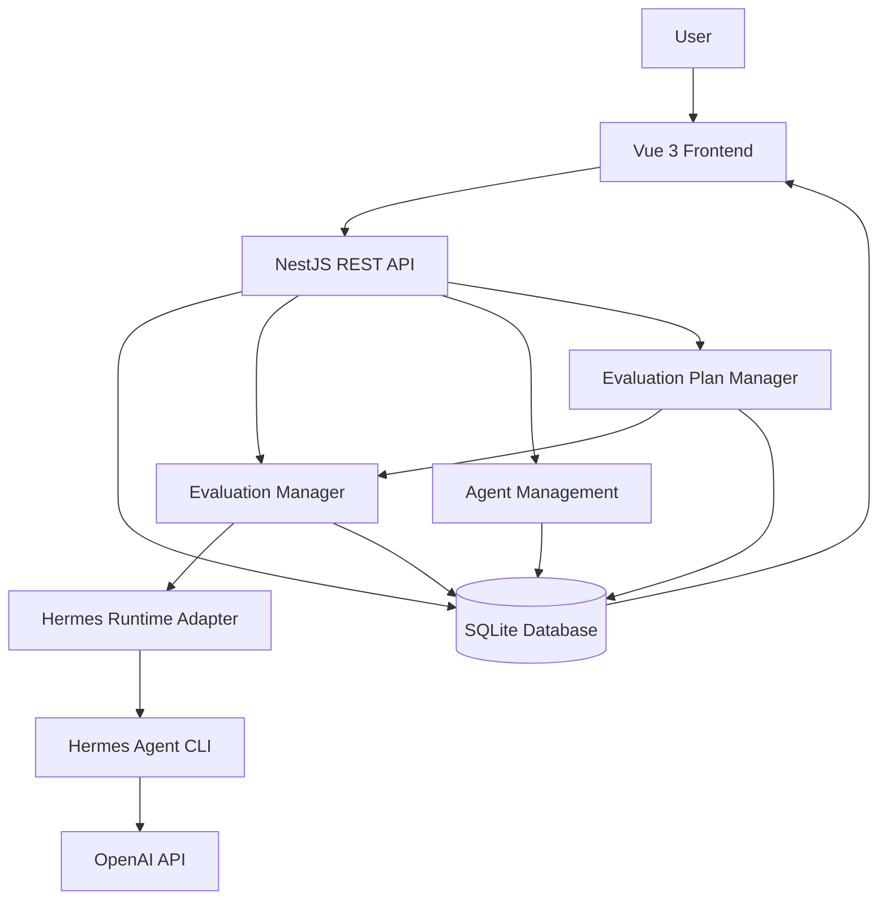
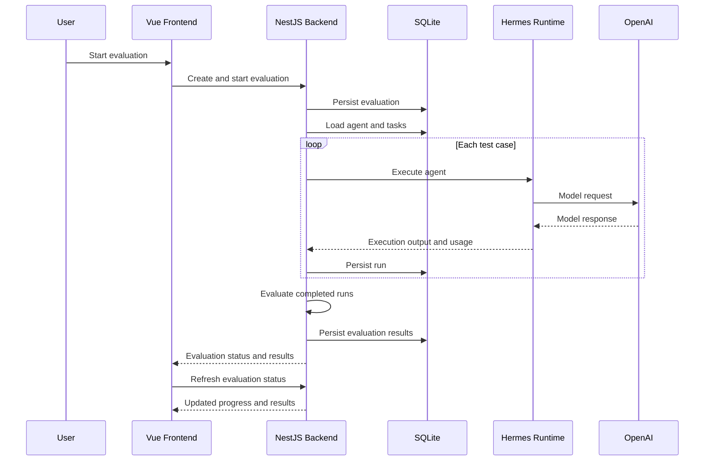

# Agent Evaluation Platform
## Technical Design Document

**Project:** Agent Evaluation Platform  
**Document type:** Architecture and Design  
**Status:** Implementation complete; local evaluation platform  
**Technology stack:** NestJS, Vue 3, TypeScript, Prisma, SQLite, Hermes Agent, OpenAI API

---

# 1. Executive Summary

The Agent Evaluation Platform provides a structured environment for configuring, testing and comparing AI agents against predefined evaluation tasks.

The primary objective is to make agent quality measurable and reproducible. Instead of relying on subjective assessments of model responses, the platform executes agents against predefined test cases and evaluates their outputs against explicit expected outcomes and scoring criteria.

The platform supports:

- Agent creation and configuration management.
- Versioned and published agent configurations.
- Task and task-suite management.
- Structured evaluation criteria and response schemas.
- Individual evaluations comparing multiple agent configurations.
- Evaluation plans for reusable evaluation configurations.
- Batch execution of multiple evaluations.
- Test-case-level scoring and result inspection.
- Cost and execution-duration tracking.
- Dashboard-level monitoring of evaluation results and regressions.

The application runs locally. SQLite provides persistence, while Hermes Agent provides the execution runtime and OpenAI provides the language model.

The implementation deliberately reuses the existing Hermes execution and evaluation mechanisms rather than introducing a separate agent execution engine.

# 2. Architecture Overview

## 2.1 High-level architecture

The system consists of four primary components:

1. Vue 3 frontend.
2. NestJS backend.
3. SQLite database accessed through Prisma.
4. Hermes Agent runtime integrated with the OpenAI API.

### Architecture diagram

The frontend communicates with the backend through REST APIs. The backend handles application logic, persistence, agent configuration management and evaluation orchestration.

The Hermes runtime adapter isolates the application from the underlying agent execution interface.

## 2.2 Technology choices

| Component | Technology | Responsibility |
|---|---|---|
| Frontend | Vue 3 + TypeScript | User interface and evaluation monitoring |
| Backend | NestJS + TypeScript | APIs, orchestration and business logic |
| Persistence | SQLite | Application and evaluation data |
| ORM | Prisma | Database access and migrations |
| Agent runtime | Hermes Agent CLI | Agent execution |
| Model provider | OpenAI API | Language model inference |
| Runtime integration | Node.js child processes | Invoking Hermes from the backend |

### Why this stack?

The stack was selected to keep the application straightforward to run locally while maintaining clear separation between the frontend, backend, persistence and agent execution layers.

SQLite removes the need for an independently managed database server. Prisma provides schema management and database migrations.

Hermes is used as the agent runtime rather than implementing a custom tool execution and agent orchestration framework.

# 3. Core Domain Design

The platform separates agent definitions, tasks, evaluations and evaluation plans.

## 3.1 Agents

An agent represents an application-level AI configuration.

It contains:

- Name and description.
- Hermes runtime profile reference.
- Provider and model configuration.
- System prompt.
- Published configuration versions.

The platform distinguishes between a draft configuration and published configurations.

A draft can be edited without changing published history. Publishing stores an immutable version when the canonical configuration changes. Evaluations reference that published version rather than the evolving draft.

### Versioning rationale

Versioning is important because evaluation results need to remain associated with the exact configuration that was tested.

For example:

- Refund Support Agent — Version 1
- Refund Support Agent — Version 2
- Refund Support Agent — Version 3

A comparison can then measure how a prompt or model configuration change affects performance.

## 3.2 Tasks and task suites

A task represents one evaluation scenario.

Each task can contain:

- Name and description.
- Input data.
- Expected outcome.
- Scoring criteria.
- Optional structured response schema.
- Task version information.

A task suite groups multiple tasks into a reusable evaluation dataset.

For example, the Refund Policy Evaluation suite contains six refund-related scenarios, including:

- Purchase yesterday.
- Purchase 20 days ago.
- Missing purchase date.
- Purchase approximately two weeks ago.
- Recently delivered product.
- Purchase date provided later.

This allows the same set of test cases to be reused across different agent configurations.

## 3.3 Evaluations

An evaluation executes a selected agent configuration against a collection of tasks.

The platform supports:

- Baseline configurations.
- Candidate configurations.
- Individual test-case execution.
- Scoring and pass/fail evaluation.
- Configuration comparison.
- Token usage and cost tracking.
- Execution-duration tracking.

The comparison functionality evaluates configurations against common test cases and reports:

- Average score changes.
- Pass-rate changes.
- Improved test cases.
- Regressed test cases.
- Unchanged test cases.
- Cost and duration differences.

The platform distinguishes execution failures from evaluation failures. A completed model execution can still produce an unsuccessful test-case result.

## 3.4 Evaluation plans and batch execution

Evaluation plans allow users to define reusable groups of evaluations.

Each plan entry specifies:

- Agent.
- Version policy.
- Selected task suite.
- Optional pass-rate threshold.
- Enabled or disabled status.

Two version policies are supported:

**Latest published**

Resolves to the latest published agent configuration when a batch starts.

**Pinned version**

Uses a specific published configuration selected by the user.

When the user triggers Run all evaluations, the backend loads all enabled plans and entries, resolves their configurations and creates individual evaluations through the existing evaluation engine.

A batch groups these individual evaluations and tracks their execution status.

The resolved agent version and task suite are persisted so that subsequent configuration changes do not alter an already-started batch.

The batch does not introduce a new evaluation engine. It orchestrates existing evaluation creation and execution workflows.

# 4. Evaluation Execution Flow

## 4.1 Individual evaluation

The individual evaluation flow is:

1. The user selects an agent and published configuration.
2. The user selects a task suite or individual tasks.
3. The backend creates an evaluation record.
4. The backend starts the required executions.
5. The Hermes runtime adapter invokes the Hermes CLI.
6. Hermes executes the agent using the configured model provider.
7. The backend captures execution output and usage information.
8. The evaluation engine evaluates the response against the expected outcome and scoring criteria.
9. Results are persisted.
10. The frontend displays evaluation and comparison results.

### Execution flow diagram

## 4.2 Batch evaluation

Batch execution reuses the individual evaluation workflow.

The user clicks Run all evaluations.

The backend:

1. Retrieves enabled evaluation plans.
2. Retrieves enabled entries.
3. Resolves published agent versions.
4. Creates a batch and its associated items.
5. Creates one existing evaluation for each valid entry.
6. Starts the individual evaluations.
7. Tracks completion and failure status.
8. Aggregates results for the batch.

One individual evaluation failing does not prevent other evaluations from running.

The batch remains available after page refresh because its execution information is persisted.

## 4.3 Execution isolation

The application uses a project-owned Hermes profile named `eval-base`.

That profile keeps provider `openai-api` and model `gpt-5.4-mini`. Its toolsets, bundled skills, and memory are disabled. The user's personal Hermes configuration is not modified.

Individual evaluation executions use temporary profiles derived from the base profile. This avoids unintentionally sharing mutable session and memory state between concurrent execution processes.

Temporary profiles are cleaned up when their processes exit.

The application-level agent definition remains separate from the Hermes runtime profile.

This separation allows different application agents to use different prompts while sharing a common runtime configuration.

# 5. Scoring and Evaluation Methodology

The platform evaluates agent responses using predefined task expectations and scoring criteria.

Each task can have multiple criteria. The evaluation records criterion-level results and an overall score.

A test case is classified as passed or failed according to the configured evaluation logic.

For comparison purposes, the platform reports:

- Average score.
- Test-case pass rate.
- Improved cases.
- Regressed cases.
- Unchanged cases.

On an evaluation comparison, pass rate is passed evaluations divided by evaluated runs. Execution failures and runs that were not evaluated are counted separately. The dashboard's daily pass rate instead divides passed test cases by completed test cases, so a completed run with no score is not omitted from that denominator.

Execution failures and cases that were not evaluated are treated separately rather than being silently counted as failed test cases.

## 5.1 Configuration comparison

When comparing a baseline against one or more candidates:

- The same task cases are used for comparison.
- Differences are calculated only for test cases evaluated under both configurations.
- Pass-rate changes are expressed in percentage points.
- Average score changes are reported separately.

This prevents misleading comparisons when configurations have different numbers of evaluated test cases.

# 6. Dashboard and Monitoring

The Dashboard is the application's landing page.

It provides a summary of:

- Total agents.
- Total tasks.
- Total task suites.
- Evaluations run today.
- Test-case pass rate today.
- Evaluation cost today.
- Agents evaluated today.

It also displays:

- Recent evaluations.
- Attention-required items.
- Evaluation plan configurations.
- Batch execution progress and results.

The platform distinguishes between evaluation execution status and evaluation quality.

For example, an evaluation may complete successfully while the agent fails several test cases.

Where usage information is available, costs are displayed with an actual or estimated classification. Missing cost information is not treated as zero.

The application uses the existing execution monitoring mechanism to update progress while evaluations are running.

# 7. Key Architecture and Design Decisions

## 7.1 Local SQLite instead of a hosted database

SQLite was selected because:

- The assignment requires local execution.
- No separate database server is necessary.
- Setup and initialization are straightforward.
- Prisma migrations provide schema management.
- Sample data can be seeded automatically.

This reduces evaluator setup requirements and external dependencies.

## 7.2 Hermes CLI instead of a custom agent runtime

Hermes provides the underlying agent execution environment.

The application integrates with Hermes through a dedicated runtime adapter.

This avoids implementing a custom agent runtime, tool execution framework and session management system.

The adapter also provides a boundary between application-level agent configuration and Hermes-specific implementation details.

## 7.3 Shared runtime profile

The application uses a project-owned base Hermes profile rather than creating an independent Hermes installation for every application agent.

Application agents maintain their own system prompts and configuration, while runtime capabilities are inherited from the selected Hermes profile.

This simplifies configuration management.

## 7.4 Configuration versioning

Published configurations are immutable snapshots.

This allows evaluation results to be associated with a specific agent configuration and supports reliable comparisons between versions.

## 7.5 Reusing the evaluation engine for batch execution

Batch execution is implemented as an orchestration layer over existing individual evaluations.

This avoids duplicating:

- Execution logic.
- Scoring logic.
- Cost calculation.
- Result persistence.
- Comparison functionality.

It also ensures that individual and batch evaluations use the same evaluation methodology.

## 7.6 Manual execution rather than automatic scheduling

Evaluation plans are manually triggered.

Automatic scheduling, recurring execution and external notifications were intentionally excluded from the current implementation.

This keeps the implementation focused on reusable evaluation configurations and batch execution.

# 8. Known Limitations

The current implementation is designed as a functional local evaluation platform and not as a fully distributed enterprise evaluation service.

The following limitations are known.

## 8.1 Local deployment

The application uses local SQLite persistence and a local Hermes installation.

It is not currently designed for multi-instance deployment with shared database state.

## 8.2 External model dependency

Actual agent execution requires a valid OpenAI API key and network access to the provider.

Model availability, latency and pricing are controlled by the provider.

## 8.3 Runtime profile capabilities

The application-level agent configuration and Hermes runtime capabilities are separate.

The current UI exposes the system prompt and the supported profile, provider, and model. Skills, toolsets, and memory are inherited from the selected Hermes profile and are not configured per agent. The project `eval-base` profile reports memory disabled and no enabled skills or toolsets.

## 8.4 Evaluation quality

Evaluation outcomes depend on the quality of:

- Test-case inputs.
- Expected outcomes.
- Scoring criteria.
- Model behaviour.
- Evaluation configuration.

A high evaluation score does not independently prove production correctness.

The quality and coverage of the evaluation dataset remain important.

## 8.5 Model variability

Language model responses can vary between executions.

Even with the same prompt and configuration, results may not be perfectly deterministic.

The platform records individual executions and their evaluation results but does not guarantee identical outputs across repeated runs.

## 8.6 Cost estimation

Cost reporting depends on usage information returned by the runtime/provider integration.

Where provider pricing information is used to calculate cost, the result is labelled estimated.

Actual costs may differ because of provider pricing changes, token accounting, caching and other provider-side factors.

Missing usage or pricing data can limit cost coverage.

## 8.7 Scheduling and notifications

Evaluation plans currently require manual execution.

The application does not currently provide:

- Recurring schedules.
- Cron-based execution.
- Email notifications.
- Slack notifications.
- Automated regression alerts outside the dashboard.

## 8.8 Distributed execution

The current execution model is designed for local application use.

It does not provide a distributed worker fleet, durable external job queue or multi-node execution orchestration.

## 8.9 Statistical significance

The comparison functionality reports observed differences in scores and pass rates.

It does not currently perform statistical significance testing or confidence-interval calculations.

Results from small test suites should therefore be interpreted cautiously.

# 9. Approximate Running Costs

The application has two main cost categories:

1. Local infrastructure.
2. External model API usage.

## 9.1 Local infrastructure

The application runs locally using:

- Vue frontend.
- NestJS backend.
- SQLite database.
- Local Hermes installation.

There is no mandatory hosted database, application server or continuously running cloud infrastructure.

| Component | Approximate infrastructure cost |
|---|---:|
| Vue frontend | $0 additional hosting cost locally |
| NestJS backend | $0 additional hosting cost locally |
| SQLite | $0 additional database hosting cost |
| Hermes CLI | $0 additional runtime licence cost assumed |
| Local storage | Uses available machine storage |

These figures exclude the user's existing hardware, electricity and internet costs.

## 9.2 Model API costs

Model API usage is the primary variable operating cost.

The amount depends on:

- Number of test cases.
- Number of agent configurations.
- Input tokens.
- Output tokens.
- Reasoning tokens, where applicable.
- Cached input usage.
- Model selection.
- Provider pricing.

The application records token usage and estimated cost for individual executions where available.

### Observed experiment costs

In the recorded Refund Support Agent evaluation runs, the following estimated costs were observed:

| Configuration | Test cases | Estimated cost |
|---|---:|---:|
| Version 2 | 6 | $0.0239 |
| Version 3 | 6 | $0.0244 |

These are observed costs from the recorded evaluation runs, not guaranteed future prices.

The original two-configuration comparison also reported that Version 2 cost approximately 2% less than Version 3 for that comparison.

The cost figures can vary between executions because model usage and token counts vary.

### Illustrative monthly usage

Using approximately $0.024 as the observed cost of one six-test-case configuration in that comparison:

| Usage | Approximate monthly model cost |
|---|---:|
| 1 evaluation per day | $0.72 |
| 5 evaluations per day | $3.60 |
| 10 evaluations per day | $7.20 |
| 20 evaluations per day | $14.40 |

Assumptions:

- One evaluation means six test cases against one configuration.
- Approximate cost is $0.024 per evaluation.
- 30-day month.
- Same model and broadly similar usage.
- No additional infrastructure charges.

These are planning estimates, not provider quotations.

Actual API costs should be calculated using the latest provider pricing and measured token consumption.

# 10. Real Experiment: Refund Support Agent Version 2 vs Version 3

## 10.1 Objective

The experiment compared two published configurations of the Refund Support Agent to measure the impact of configuration changes on refund-policy evaluation performance.

The objective was to determine whether Version 2 performed better than Version 3 on the same evaluation dataset.

## 10.2 Experiment configuration

| Parameter | Configuration |
|---|---|
| Agent | Refund Support Agent |
| Baseline | Version 3 |
| Candidate | Version 2 |
| Model | gpt-5.4-mini |
| Task suite | Refund Policy Evaluation |
| Test cases | 6 |
| Planned executions | 12 |
| Completed executions | 12 |

Both configurations were evaluated against the same six test cases.

## 10.3 Results

| Metric | Version 3 (Baseline) | Version 2 (Candidate) |
|---|---:|---:|
| Average score | 0.62 | 1.00 |
| Pass rate | 33% | 100% |
| Passed test cases | 2 | 6 |
| Failed test cases | 4 | 0 |

### Comparison summary

| Metric | Observed change |
|---|---:|
| Average score improvement | +0.38 |
| Pass-rate improvement | +67 percentage points |
| Improved test cases | 4 |
| Regressed test cases | 0 |
| Unchanged test cases | 2 |

Version 2 performed better than Version 3 across the evaluation dataset.

Four test cases improved, none regressed, and two remained unchanged.

## 10.4 Interpretation

Version 2 achieved a 100% pass rate compared with 33% for Version 3.

The average score increased from 0.62 to 1.00.

The results indicate that Version 2 handled the tested refund-policy scenarios more consistently than Version 3.

The experiment also demonstrates the value of evaluating agent configurations against a fixed task suite rather than relying only on manual inspection of model responses.

However, the evaluation contains only six test cases.

The result should therefore be interpreted as an improvement on this particular dataset, not proof that Version 2 is universally superior across all possible refund-support scenarios.

## 10.5 Cost observation

The recorded comparison reported that Version 2 cost approximately 2% less than Version 3, with costs classified as estimated.

This suggests that the observed quality improvement did not require a corresponding increase in reported model cost for this experiment.

Cost comparisons should be repeated over additional executions before drawing broader conclusions.

# 11. Future Improvements

The following are possible future extensions, not part of the current implementation:

- Multiple runtime capability profiles.
- Per-agent capability configuration.
- Additional model providers.
- More advanced evaluation metrics.
- Larger and more diverse evaluation datasets.
- Statistical comparison methods.
- Distributed evaluation workers.
- Hosted database and multi-user deployment.
- Scheduled evaluations and notifications.
- Historical quality and cost trend analysis.

These extensions can be introduced independently without requiring a replacement of the existing evaluation engine.

# 12. Conclusion

The Agent Evaluation Platform establishes a reusable workflow for configuring, executing and comparing AI agents.

Its central design principle is separation of concerns:

- Agent configuration defines agent behaviour.
- Tasks define evaluation scenarios.
- Task suites define reusable evaluation datasets.
- Hermes provides the agent runtime.
- The evaluation engine measures agent performance.
- Evaluation plans define reusable groups of evaluations.
- Batch execution orchestrates multiple evaluations.
- The Dashboard provides an operational overview of evaluation health.

The implementation prioritizes local reproducibility, explicit configuration versioning, reusable evaluation workflows and visibility into quality and cost.

The Version 2 versus Version 3 experiment demonstrates how the platform can identify measurable differences between agent configurations using a consistent evaluation dataset.

The current system provides a foundation for more advanced agent evaluation and regression-testing workflows without introducing unnecessary infrastructure or a separate execution engine.